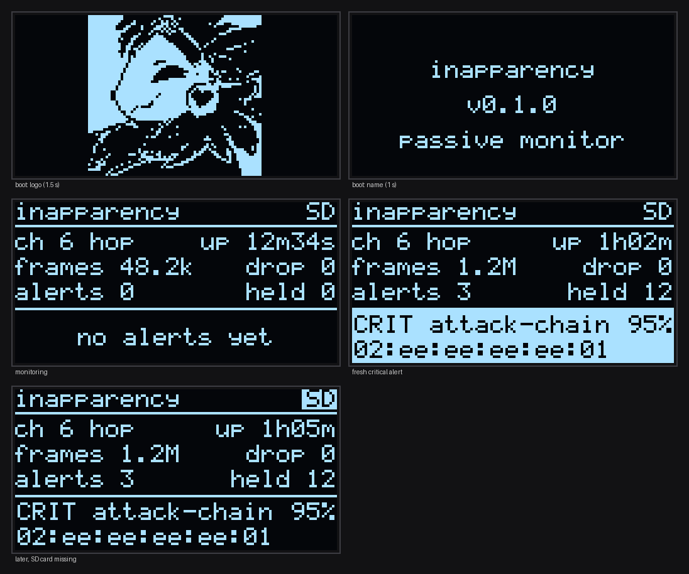

# Optional modules

Both are **off by default** and switched on in `idf.py menuconfig` under
**inapparency**. If a module isn't connected or fails, the firmware says so
on serial and keeps monitoring without it.

## OLED display

Any 128x64 I2C OLED: the common 0.96" (SSD1306) or 1.3" (SH1106) modules.



- **Splash** at boot: the logo for 1.5 s, then the name and version
- **Status**: channel, uptime, frames seen, frames dropped, alerts,
  alerts held back by the rate limit
- **Last alert**: severity, rule, confidence and BSSID. High and critical
  alerts are shown inverted for 10 s so they stand out across the room.
- The `SD` marker in the header turns inverted when the card is missing or
  failing

The splash logo is generated from `assets/` by `tools/make_logo.py`, which
takes the braille art or any picture and fits it to the screen:

```sh
python3 tools/make_logo.py assets/protogen-braille.txt
```

Check layouts on a laptop without a screen:

```sh
./build/tools/display_preview/inapparency-display-preview
```

### Wiring

| OLED | ESP32 | ESP32-S3 | ESP32-C3 | ESP32-C6 |
|---|---|---|---|---|
| VCC | 3V3 | 3V3 | 3V3 | 3V3 |
| GND | GND | GND | GND | GND |
| SDA | GPIO21 | GPIO8 | GPIO4 | GPIO6 |
| SCL | GPIO22 | GPIO9 | GPIO5 | GPIO7 |

All pins, the I2C address (0x3C or 0x3D), the controller and 180° rotation
can be changed in menuconfig. The C3 and C6 defaults stay away from their
strapping pins.

**Picture shifted by 2 px or garbage on the edge?** Switch the controller
between SSD1306 and SH1106.

## SD card logging

A microSD module over SPI. The card must be **FAT32 formatted**. It's never
formatted automatically, so nothing on it gets wiped.

Writes `/sdcard/inapp.log`, one JSON object per line, in the same format as
the serial JSON output:

```json
{"type":"boot","boot":12,"version":"0.1.0","target":"esp32"}
{"type":"event","t_ms":55250,"rule":"evil-twin","rule_id":4,"severity":"high","confidence":85,...}
{"type":"status","uptime_ms":300000,"frames":48213,...}
```

- When the file reaches the size limit (default 512 KB) it becomes
  `inapp1.log`, the previous one `inapp2.log`, and so on. Two old files are
  kept by default.
- Each line is synced to the card before the next, so pulling the power
  loses at most one line.
- Boards have no real-time clock, so `t_ms` is time since boot. The `boot`
  line and its counter (stored in flash) tell runs apart.
- A status line goes in every 5 minutes, so you can see the board was alive
  even when nothing happened.

### Wiring

| SD module | ESP32 | ESP32-S3 | ESP32-C3 | ESP32-C6 |
|---|---|---|---|---|
| VCC | 3V3 or 5V (check the module) | same | same | same |
| GND | GND | GND | GND | GND |
| MOSI | GPIO23 | GPIO11 | GPIO7 | GPIO18 |
| MISO | GPIO19 | GPIO13 | GPIO1 | GPIO20 |
| SCK | GPIO18 | GPIO12 | GPIO6 | GPIO19 |
| CS | GPIO5 | GPIO10 | GPIO10 | GPIO21 |

All configurable in menuconfig, along with the size limit, how many old
files to keep and the status interval.

## Writing your own module

Modules receive events through `inapparency::EventSink` and get added to the
`EventFanout` in `firmware/main/main.cpp`. Rules for keeping the core safe:

- Don't block in `emit()`. It runs on the detection task. Copy the event
  into a queue and do slow work (I/O, drawing) on your own task.
- Never stop detection when the module fails. Log it and carry on.
- Keep hardware code in `platform/espidf/`. Anything that can be tested on a
  laptop (layouts, formats, file rotation) goes in `modules/` with tests.
